# 🚀 SkillXchange — Cloud-Native DevOps & Kubernetes Transformation

<p align="center">
  
  
  
  
  
  
  
  
  
  
</p>

<p align="center">
  <b>Enterprise-grade, end-to-end DevOps re-engineering of the SkillXchange platform: Monolith Decoupling, Multi-Node Kubernetes Orchestration, StatefulSets with PVC Persistence, Dynamic HPA Autoscaling, Helm Packaging, Automated CI/CD Pipelines, Full-Stack Observability, and DevSecOps Container Scanning.</b>
</p>

---

## 📌 Executive Summary

Originally developed as a monolithic PHP/MySQL web application hosted on an unscalable local XAMPP runtime, **SkillXchange** has been re-architected into a resilient, highly available, and production-ready cloud-native distributed platform compliant with **12-Factor App** principles.

This project demonstrates practical mastery across the full modern DevOps lifecycle:
- **Containerization & Decoupling**: Separation of concerns into specialized, lightweight NGINX Alpine, PHP 8.2-FPM, and MariaDB 10.11 containers.
- **Multi-Node Kubernetes Clustering**: High availability deployment across a 3-node cluster (1 Control Plane + 2 Workers) with Pod anti-affinity.
- **Stateful Persistence**: Headless Services and `StatefulSet` with dynamic `PersistentVolumeClaims` guaranteeing zero data loss.
- **Elastic Autoscaling & Ingress**: Metrics Server-driven Horizontal Pod Autoscaler (HPA) dynamically scaling replicas from 2 to 5 under peak load, exposed via Ingress routing.
- **Package Management**: Complete application stack packaged into a parameterized Helm v3 chart.
- **Automated CI/CD**: GitHub Actions workflow executing code linting, Helm validation, and multi-stage container builds pushed to GitHub Container Registry (GHCR).
- **Observability**: Real-time cluster monitoring and telemetry scraping with Prometheus and Grafana dashboards.
- **DevSecOps**: Automated vulnerability scanning and hardcoded secret detection with Aqua Security Trivy.

---

## 🏛️ Comprehensive Architecture

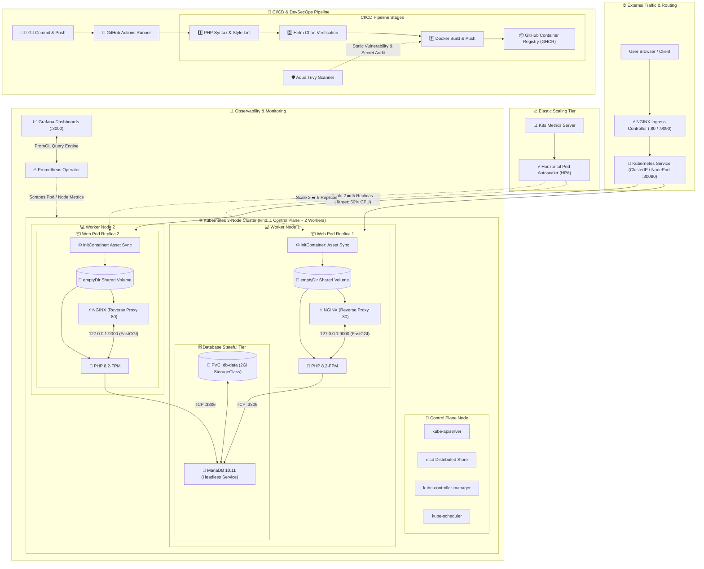

---

## 🛠️ DevOps Competencies & Technology Stack

| Domain | Technology / Pattern | Engineering Implementation Details |
| :--- | :--- | :--- |
| **Container Engine** | Docker Engine & Desktop | Multi-stage Dockerfile, Alpine base images, non-root users, hardened `.dockerignore` |
| **Local Orchestration**| Docker Compose v2 | Multi-container stack (NGINX, PHP-FPM, MariaDB, phpMyAdmin) with bridge networks and volumes |
| **Web Server Tier** | NGINX (Alpine Linux) | High-concurrency static asset caching, FastCGI routing, custom reverse proxy configuration |
| **Backend Runtime** | PHP 8.2-FPM | Decoupled MVC backend, isolated database drivers, unix/TCP socket communication |
| **Database Tier** | MariaDB 10.11 | Kubernetes `StatefulSet` with headless service, automated SQL initialization of 22 tables |
| **Storage & Persistence**| PV / PVC / StorageClasses | Persistent disk lifecycle via `local-path-storage`, zero data loss on container recreation |
| **Cluster Topology** | Kubernetes (`kind`) | 3-Node Cluster (1 Control-Plane + 2 Worker Nodes) powered by `containerd` |
| **Configuration** | 12-Factor Config | Decoupled runtime configuration via `ConfigMaps` and base64-encoded `Secrets` |
| **Pod Patterns** | Sidecar & InitContainer | Multi-container pods (NGINX + PHP) sharing memory-mapped code volumes populated at boot |
| **High Availability** | K8s Deployment Replicas | Multi-replica deployments with Pod anti-affinity to ensure scheduling across physical nodes |
| **Elastic Autoscaling**| K8s Metrics Server & HPA | Dynamic CPU-based scaling (2 min, 5 max replicas) validated with synthetic load generator |
| **Package Management** | Helm v3 Charts | Production Helm chart (`helm/skillxchange`) with templates, dynamic helpers, and `values.yaml` |
| **Ingress & Traffic** | NGINX Ingress Controller | Path-based HTTP ingress routing, custom node tolerations, host-port mapping |
| **CI/CD Automation** | GitHub Actions & GHCR | Automated pipeline testing PHP, validating Helm charts, and publishing tagged container images |
| **Observability** | Prometheus & Grafana | `kube-prometheus-stack` monitoring cluster resources, node CPU/Memory, and pod latency |
| **DevSecOps** | Aqua Security Trivy | Container image vulnerability scan (CVEs), package severity analysis, hardcoded secret audit |

---

## 📂 Repository Layout

```text
SkillXchange/
├── .github/
│   └── workflows/
│       └── ci-cd.yaml          # GitHub Actions CI/CD Pipeline (Lint, Helm, Build, Push)
├── app/                        # Decoupled PHP MVC Application Core
│   ├── config/                 # Database, session, and application configurations
│   ├── controllers/            # Controller layer
│   ├── models/                 # Model & ORM layer
│   └── views/                  # Presentation templates
├── docker/
│   └── nginx/
│       └── default.conf        # Docker Compose NGINX FastCGI reverse proxy config
├── helm/
│   └── skillxchange/           # Production Helm v3 Chart
│       ├── Chart.yaml          # Chart metadata (v0.1.0)
│       ├── values.yaml         # Configurable parameters (replicas, image, resources)
│       └── templates/          # K8s manifest templates (deployment, service, statefulset, etc.)
├── k8s/                        # Pure Declarative Kubernetes Manifests
│   ├── kind-config.yaml        # 3-Node Cluster Topology specification
│   ├── namespace.yaml          # Isolated 'skillxchange' namespace
│   ├── configmap.yaml          # Environment configuration ConfigMap
│   ├── secrets.yaml            # Encrypted sensitive credentials
│   ├── nginx-k8s.conf          # Kubernetes FastCGI routing to 127.0.0.1:9000
│   ├── db.yaml                 # MariaDB Headless Service & StatefulSet (2Gi PVC)
│   ├── web.yaml                # NGINX + PHP-FPM Sidecar Deployment & Service
│   ├── hpa.yaml                # Horizontal Pod Autoscaler manifest
│   ├── ingress.yaml            # Ingress controller routing configuration
│   └── metrics-server.yaml     # Custom metrics server with insecure TLS flag
├── public/                     # Public web root & static UI assets
├── screen_shots/               # Verified architectural and operational evidence screenshots
├── DB.sql                      # Complete 22-table database schema seed
├── Dockerfile                  # Production-hardened PHP 8.2-FPM container build recipe
├── docker-compose.yml          # Local developer multi-container stack
├── .dockerignore               # Build context optimization
└── README.md                   # Enterprise engineering documentation
```

---

## 📸 Architectural & Operational Evidence Gallery

All phases have been executed, verified, and evidenced with captured technical artifacts:

### Phase 1 & 2: Containerization & Local Multi-Container Stack
Decoupling of the legacy monolithic Apache/PHP application into dedicated micro-containers with persistent database storage.

| Docker Compose Multi-Container Stack | MariaDB Database Seeding (22 Tables) |
| :---: | :---: |
| 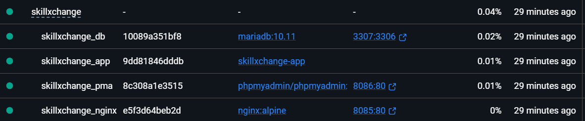 |  |

---

### Phase 3: Kubernetes Core Architecture & Multi-Node Cluster
Bootstrapping a 3-node cluster, provisioning StatefulSets with persistent volume claims, deploying high-availability web pods with sidecar containers, and serving live traffic.

| 3-Node Cluster Topology Ready | StatefulSet & PVC Storage Binding |
| :---: | :---: |
| 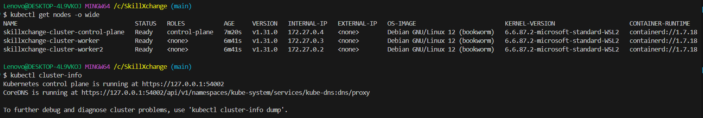 | 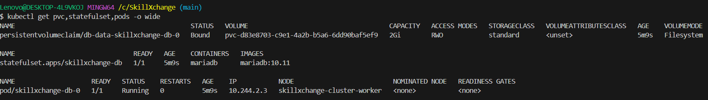 |

| High-Availability Web Replicas Across Nodes | Live Application Running on Kubernetes |
| :---: | :---: |
| 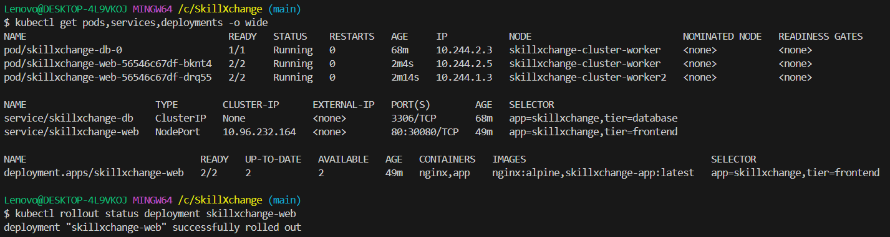 | 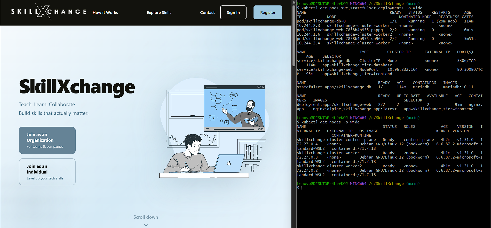 |

---

### Phase 4: Advanced Kubernetes — Autoscaling, Helm & Ingress
Deploying the Kubernetes Metrics Server, configuring Horizontal Pod Autoscaler (HPA), executing synthetic CPU load tests to trigger auto-scaling from 2 to 5 pods, packaging the stack into Helm v3, and routing traffic via NGINX Ingress Controller.

| HPA Autoscaling Under Load (2 ➡️ 5 Replicas) | Helm v3 Release (`sx-release`) Deployed |
| :---: | :---: |
| 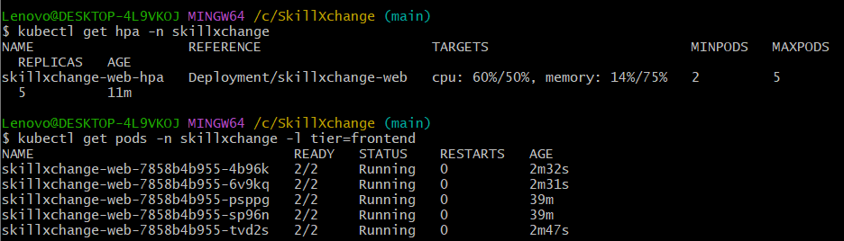 | 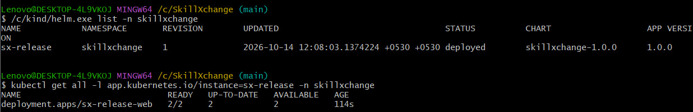 |

| NGINX Ingress Controller Live Traffic Routing |
| :---: |
| 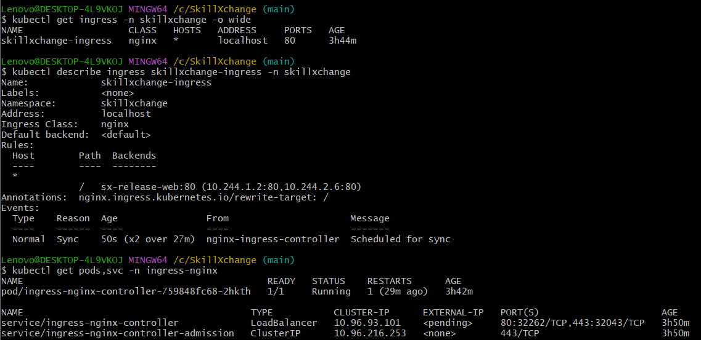 |

---

### Phase 5: Automated CI/CD Pipeline (GitHub Actions & GHCR)
Fully automated CI/CD pipeline triggered on git push: executing PHP syntax linting, Helm chart validation, and multi-stage container image compilation published directly to GitHub Container Registry (GHCR) in 1m 43s.

| Automated GitHub Actions Pipeline Success |
| :---: |
| 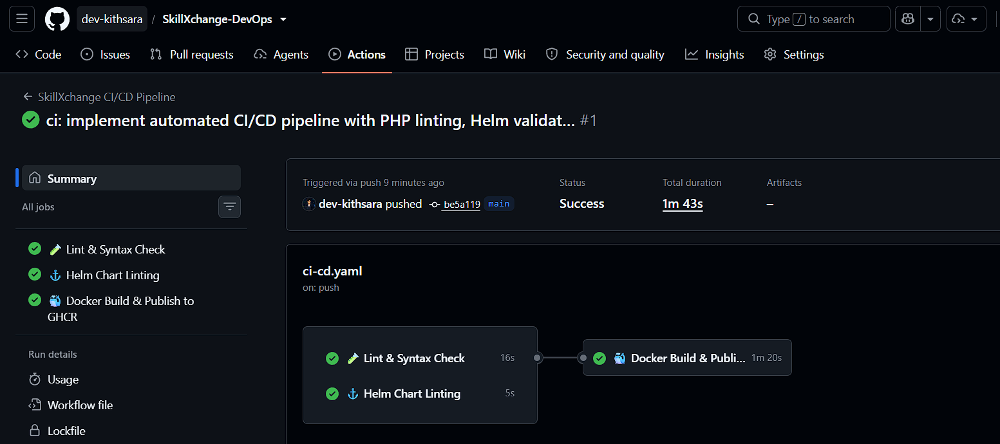 |

---

### Phase 6: Full-Stack Observability (Prometheus & Grafana)
Deploying `kube-prometheus-stack` Helm chart to scrape cluster-level and pod-level metrics, visualized through real-time Grafana dashboards.

| Live Grafana Cluster & Pod Performance Dashboard |
| :---: |
| 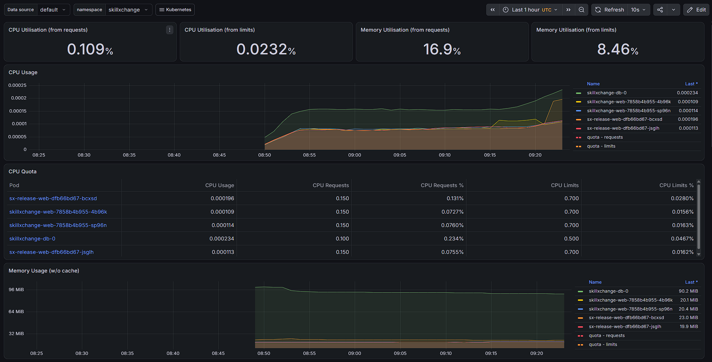 |

---

### Phase 7: DevSecOps & Container Security Audit (Aqua Trivy)
Automated static vulnerability scanning of the production container image (`skillxchange-app:latest`) identifying CVEs and detecting hardcoded secrets prior to deployment.

| Aqua Security Trivy Vulnerability & Secret Scan Report |
| :---: |
| 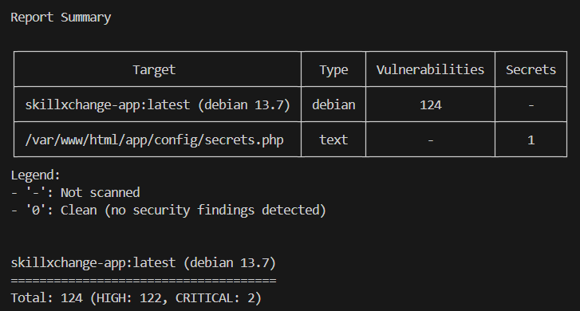 |

---

## 🚦 Deployment & Operations Manual

### Mode 1: Local Development with Docker Compose

```bash
# 1. Build and start the entire multi-container stack in background
docker compose up -d --build

# 2. Verify all container services are running healthy
docker compose ps

# 3. Access applications:
# - Web Application: http://localhost:8085
# - phpMyAdmin:      http://localhost:8086 (root / root)
```

---

### Mode 2: Multi-Node Kubernetes Deployment (Raw Manifests)

#### 1. Spin up the 3-Node Cluster
```bash
kind create cluster --config k8s/kind-config.yaml
kubectl cluster-info
kubectl get nodes
```

#### 2. Load Local Container Image into Cluster
```bash
kind load docker-image skillxchange-app:latest --name skillxchange-cluster
```

#### 3. Provision Core Resources, Secrets & Storage
```bash
# Apply namespace, configurations, and secrets
kubectl apply -f k8s/namespace.yaml
kubectl apply -f k8s/configmap.yaml
kubectl apply -f k8s/secrets.yaml

# Provision NGINX FastCGI reverse proxy ConfigMap
kubectl create configmap nginx-config --from-file=default.conf=k8s/nginx-k8s.conf -n skillxchange

# Deploy MariaDB StatefulSet with 2Gi PersistentVolumeClaim
kubectl apply -f k8s/db.yaml

# Seed the 22-table database schema
kubectl exec -i skillxchange-db-0 -n skillxchange -- mariadb -u root -proot skillxchange < DB.sql

# Deploy High-Availability Web Application (NGINX + PHP-FPM Sidecar)
kubectl apply -f k8s/web.yaml
```

#### 4. Configure Elastic Scaling (HPA) & Ingress
```bash
# Deploy Metrics Server
kubectl apply -f k8s/metrics-server.yaml

# Deploy Horizontal Pod Autoscaler
kubectl apply -f k8s/hpa.yaml

# Deploy NGINX Ingress Controller & Ingress rules
kubectl apply -f https://raw.githubusercontent.com/kubernetes/ingress-nginx/main/deploy/static/provider/kind/deploy.yaml
kubectl apply -f k8s/ingress.yaml
```

---

### Mode 3: Enterprise Deployment via Helm v3

```bash
# 1. Lint the Helm chart for syntax and best practices
helm lint helm/skillxchange

# 2. Deploy or upgrade the release
helm upgrade --install sx-release helm/skillxchange -n skillxchange --create-namespace

# 3. Verify deployed release and associated pods
helm list -n skillxchange
kubectl get all -n skillxchange
```

---

### Mode 4: Observability & Security Auditing

```bash
# Launch Prometheus & Grafana stack via Helm
helm repo add prometheus-community https://prometheus-community.github.io/helm-charts
helm repo update
helm install monitoring prometheus-community/kube-prometheus-stack -n monitoring --create-namespace

# Access Grafana Dashboards
kubectl port-forward svc/monitoring-grafana 3000:80 -n monitoring
# Open http://localhost:3000 (admin / prom-operator)

# Run Aqua Security Trivy Vulnerability Scan
docker run --rm -v //var/run/docker.sock:/var/run/docker.sock \
  aquasec/trivy:latest image --severity HIGH,CRITICAL skillxchange-app:latest
```

---

## 📈 Completed Engineering Milestones

- [x] **Phase 1: Docker Fundamentals** — Optimized PHP 8.2-FPM Dockerfile, multi-stage caching, hardened `.dockerignore`.
- [x] **Phase 2: Multi-Container Orchestration** — Decoupled NGINX Alpine, PHP-FPM, MariaDB 10.11, and phpMyAdmin via Docker Compose.
- [x] **Phase 3: Kubernetes Core Architecture** — Multi-node `kind` cluster (1 CP + 2 Workers), StatefulSets, 2Gi PVC persistence, NGINX+PHP Sidecar pods, initContainer asset sync, zero-downtime rolling updates.
- [x] **Phase 4: Kubernetes Advanced** — Metrics Server integration, dynamic HPA CPU autoscaling (2 ➡️ 5 pods), Helm v3 chart packaging (`helm/skillxchange`), NGINX Ingress Controller routing.
- [x] **Phase 5: Automated CI/CD Pipeline** — GitHub Actions workflow executing automated PHP syntax linting, Helm chart linting, and Docker container build & push to GitHub Container Registry (GHCR).
- [x] **Phase 6: Full-Stack Observability** — Deployed `kube-prometheus-stack` operator, Prometheus metric scraping, and Grafana cluster/namespace telemetry visualization.
- [x] **Phase 7: DevSecOps & Security Hardening** — Aqua Security Trivy container CVE vulnerability scanning, static security audits, and secrets detection.

---

## 👤 Author & Contact

**Kithsara**  
- **GitHub**: [@dev-kithsara](https://github.com/dev-kithsara)  
- **Project Repository**: [SkillXchange-DevOps](https://github.com/dev-kithsara/SkillXchange-DevOps)  
- **Focus**: Cloud-Native Architecture | Kubernetes | CI/CD | DevSecOps | Platform Engineering