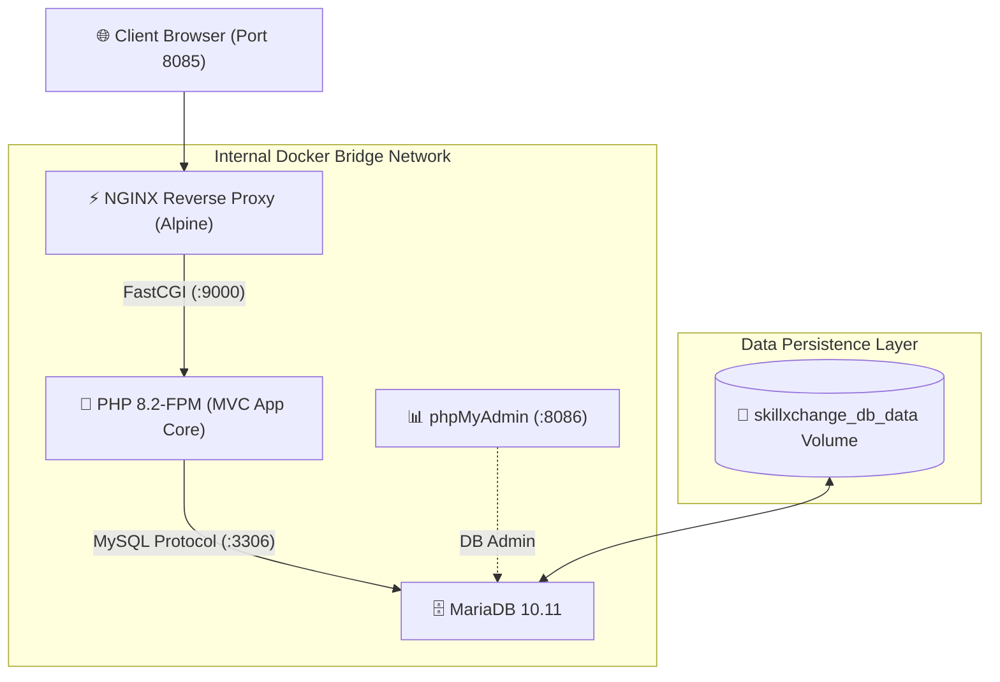

# 🚀 SkillXchange — DevOps & Cloud-Native Transformation

<p align="center">
  
  
  
  
  
  
</p>

<p align="center">
  <b>An enterprise-grade DevOps transformation of SkillXchange: Containerization, Microservice Decoupling, Kubernetes Orchestration, and Automated CI/CD.</b>
</p>

---

## 📌 Architectural Transformation

Traditionally developed on a monolithic local XAMPP stack, **SkillXchange** has been re-architected into decoupled, cloud-ready services following **12-Factor App** principles.

### High-Level Architecture (Docker & Kubernetes)



---

## 🛠️ Tech Stack & DevOps Competencies

| Domain | Technology / Tool | Implementation Scope |
| :--- | :--- | :--- |
| **Container Engine** | Docker Desktop & CLI | Dockerfile optimization, non-root user permissions, lifecycle control |
| **Web Server** | NGINX (Alpine Linux) | Reverse proxy, static asset cache, FastCGI parameter routing |
| **Backend Service** | PHP 8.2-FPM | FastCGI Process Manager, PDO extensions, dynamic worker pool |
| **Database** | MariaDB 10.11 | Containerized RDBMS, named volume persistence, automated SQL initialization |
| **Orchestration (Dev)** | Docker Compose v2 | Multi-container networking, healthchecks, environment variable injection |
| **Orchestration (Prod)** | Kubernetes (`kind`) | Pods, Deployments, Services, ConfigMaps, Secrets, Ingress, HPA |
| **CI/CD** | GitHub Actions | Automated linting, Docker image build & multi-platform packaging |
| **Observability** | Prometheus & Grafana | Metrics scraping, cluster health, resource utilization dashboards |
| **Security** | Trivy & Push Protection | Vulnerability scanning, container security benchmarks |

---

## 📂 Project Structure

```text
SkillXchange/
├── .github/
│   └── workflows/              # GitHub Actions CI/CD pipelines
├── app/                        # Application MVC Architecture
│   ├── config/                 # Environment & Database configurations
│   ├── controllers/            # Controller layer
│   ├── models/                 # Model & ORM layer
│   └── views/                  # UI view templates
├── docker/
│   └── nginx/
│       └── default.conf        # Production NGINX VirtualHost & FastCGI config
├── k8s/                        # Kubernetes Declarative Manifests
│   ├── namespace.yaml
│   ├── configmap.yaml
│   ├── secrets.yaml
│   ├── web-deployment.yaml
│   ├── web-service.yaml
│   ├── db-statefulset.yaml
│   ├── ingress.yaml
│   └── hpa.yaml
├── public/                     # Public web root & static assets
├── DB.sql                      # Initial database seed dump
├── Dockerfile                  # PHP-FPM optimized build recipe
├── docker-compose.yml          # Multi-container local orchestration
├── .dockerignore               # Build context optimization
└── README.md                   # Project documentation
```

---

## 🚀 Quick Start (Local Docker Compose)

### Prerequisites
- [Docker Desktop](https://www.docker.com/products/docker-desktop/) installed & running
- Git

### 1. Clone the Repository
```bash
git clone https://github.com/dev-kithsara/SkillXchange-DevOps.git
cd SkillXchange-DevOps
```

### 2. Launch the Multi-Container Stack
```bash
docker compose up -d --build
```

### 3. Verify Running Services
```bash
docker compose ps
```

### 4. Access Endpoints
| Service | URL | Credentials / Notes |
| :--- | :--- | :--- |
| **SkillXchange Web App** | [http://localhost:8085](http://localhost:8085) | Served via NGINX + PHP-FPM |
| **phpMyAdmin GUI** | [http://localhost:8086](http://localhost:8086) | User: `root` \| Password: `root` |
| **MariaDB Direct Port** | `localhost:3307` | Database: `skillxchange` |

---

## ☸️ Kubernetes Deployment Overview

The project is structured to deploy smoothly on any certified CNCF Kubernetes cluster (e.g., `kind`, `Minikube`, `EKS`, `GKE`).

```bash
# 1. Create dedicated namespace
kubectl apply -f k8s/namespace.yaml

# 2. Apply ConfigMaps and Secrets
kubectl apply -f k8s/configmap.yaml
kubectl apply -f k8s/secrets.yaml

# 3. Deploy Stateful Database Layer
kubectl apply -f k8s/db-pvc.yaml
kubectl apply -f k8s/db-statefulset.yaml
kubectl apply -f k8s/db-service.yaml

# 4. Deploy Frontend/App Tier & Ingress
kubectl apply -f k8s/web-deployment.yaml
kubectl apply -f k8s/web-service.yaml
kubectl apply -f k8s/ingress.yaml
```

---

## 🔐 Key DevOps Highlights

* **Decoupled Web Tier**: Shifted from monolithic Apache mod_php to an asynchronous, event-driven NGINX + PHP-FPM topology.
* **Optimized Image Footprint**: Lightweight Alpine base images with minimal attack surfaces.
* **Isolated Networking**: Internal Docker bridge network ensuring database ports remain shielded from public exposure.
* **Automated Data Seeding**: Automatic execution of SQL schema and seeds on fresh volume initialization.
* **Security-First Approach**: Hardened `.dockerignore` to prevent secrets, development logs, and Git metadata from leaking into containers.

---

## 👤 Author
**Kithsara** — [GitHub Profile](https://github.com/dev-kithsara)