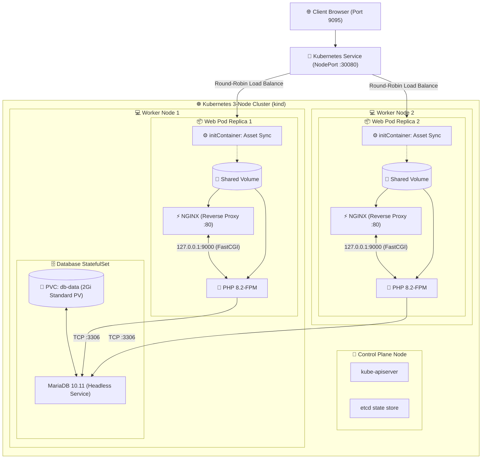

# 🚀 SkillXchange — Cloud-Native DevOps Transformation

<p align="center">
  
  
  
  
  
  
</p>

<p align="center">
  <b>Production-grade DevOps re-engineering of the SkillXchange platform: Monolith Decoupling, Microservices, Multi-Node Kubernetes Orchestration, Persistent StatefulSets, and High Availability.</b>
</p>

---

## 📌 Executive Summary

Originally built on a monolithic local XAMPP runtime, **SkillXchange** has been re-architected from the ground up into a resilient, cloud-native containerized architecture compliant with **12-Factor App** design patterns. 

This project serves as a practical demonstration of real-world DevOps competencies across containerization, microservice decoupling, infrastructure-as-code manifests, and Kubernetes workload orchestration.

---

## 🏛️ System Architecture

### High-Level Kubernetes Topology



---

## 🛠️ DevOps Competencies Demonstrated

| Domain | Technology / Pattern | Technical Implementation |
| :--- | :--- | :--- |
| **Container Engine** | Docker Desktop & Engine | Self-contained, multi-stage optimized builds, non-root users, hardened `.dockerignore` |
| **Web Server Tier** | NGINX (Alpine Linux) | High-concurrency static file caching, FastCGI parameter routing, reverse proxy |
| **Backend Tier** | PHP 8.2-FPM | FastCGI Process Manager, decoupled MVC architecture, isolated database drivers |
| **Database Tier** | MariaDB 10.11 | Kubernetes `StatefulSet`, automated SQL schema seeding, 22 relational tables loaded |
| **Storage & Persistence**| PV / PVC / StorageClasses | Persistent disk binding via `local-path-storage`, zero data-loss pod lifecycle |
| **Cluster Topology** | Kubernetes (`kind`) | 3-Node Cluster (1 Control-Plane + 2 Worker Nodes), container runtime `containerd` |
| **Configuration** | 12-Factor Config | Dynamic `ConfigMaps` (runtime variables) and base64 encoded `Secrets` |
| **Pod Patterns** | Sidecar & InitContainer | Multi-container pods (NGINX + PHP-FPM) sharing memory-mapped code volumes |
| **High Availability** | K8s Deployment Replicas | Anti-affinity scheduling placing replicas across separate worker nodes |
| **Deployment Strategy** | Rolling Updates | Zero-downtime rolling deployment with dynamic readiness/liveness probes |

---

## 📂 Project Structure

```text
SkillXchange/
├── .github/
│   └── workflows/              # GitHub Actions CI/CD pipelines (Phase 5)
├── app/                        # Application MVC Architecture
│   ├── config/                 # Environment & Database configurations
│   ├── controllers/            # Controller layer
│   ├── models/                 # Model & ORM layer
│   └── views/                  # UI view templates
├── docker/
│   └── nginx/
│       └── default.conf        # Local Docker Compose NGINX configuration
├── k8s/                        # Kubernetes Declarative Manifests
│   ├── kind-config.yaml        # 3-Node Cluster Topology configuration
│   ├── namespace.yaml          # Isolated namespace manifest
│   ├── configmap.yaml          # Externalized environment variables
│   ├── secrets.yaml            # Sensitive database credentials
│   ├── nginx-k8s.conf          # Kubernetes-specific FastCGI routing
│   ├── db.yaml                 # MariaDB Headless Service & StatefulSet + PVC
│   ├── web.yaml                # NGINX + PHP-FPM Sidecar Deployment & Service
│   └── ingress.yaml            # Ingress route definition
├── public/                     # Public web root & static assets
├── DB.sql                      # Complete 22-table database schema seed
├── Dockerfile                  # PHP-FPM container image build recipe
├── docker-compose.yml          # Local multi-container development environment
├── .dockerignore               # Build context optimization
└── README.md                   # Enterprise documentation
```

---

## 🚦 Deployment & Execution Guide

### Mode 1: Local Docker Compose (Development)

Run the full local multi-container stack (NGINX, PHP-FPM, MariaDB, and phpMyAdmin) with a single command:

```bash
# 1. Start the containers
docker compose up -d --build

# 2. Verify health status
docker compose ps

# 3. Access endpoints
# - Web Application: http://localhost:8085
# - phpMyAdmin:      http://localhost:8086 (root / root)
```

---

### Mode 2: Kubernetes Multi-Node Deployment (Production Mode)

#### 1. Spin up the 3-Node Cluster
```bash
kind create cluster --config k8s/kind-config.yaml
```

#### 2. Load the Application Image
```bash
kind load docker-image skillxchange-app:latest --name skillxchange-cluster
```

#### 3. Deploy Kubernetes Manifests
```bash
# Set up Namespace, Configs, and Secrets
kubectl apply -f k8s/namespace.yaml
kubectl apply -f k8s/configmap.yaml
kubectl apply -f k8s/secrets.yaml

# Create ConfigMap for NGINX FastCGI routing
kubectl create configmap nginx-config --from-file=default.conf=k8s/nginx-k8s.conf -n skillxchange

# Deploy Stateful Database & Seed Data
kubectl apply -f k8s/db.yaml
kubectl exec -i skillxchange-db-0 -n skillxchange -- mariadb -u root -proot skillxchange < DB.sql

# Deploy High-Availability Web Application
kubectl apply -f k8s/web.yaml
```

#### 4. Access the Live Application
```bash
kubectl port-forward svc/skillxchange-web 9095:80 -n skillxchange
# Open http://localhost:9095 in your browser
```

---

## 📈 Roadmap & Completed Milestones

- [x] **Phase 1: Docker Fundamentals** — Optimized Dockerfile, `.dockerignore`, container lifecycle management.
- [x] **Phase 2: Multi-Container Orchestration** — NGINX Alpine reverse proxy, PHP-FPM backend, MariaDB persistence.
- [x] **Phase 3: Kubernetes Core Architecture** — 3-Node `kind` cluster, Namespaces, Sidecar Pods, StatefulSets, PVCs, rolling updates.
- [ ] **Phase 4: Kubernetes Advanced** — Horizontal Pod Autoscaling (HPA), Metrics Server, Helm Packaging.
- [ ] **Phase 5: CI/CD Pipeline** — GitHub Actions automated build, test, and GHCR container registry publishing.
- [ ] **Phase 6: Observability** — Prometheus metrics scraping and Grafana health dashboards.
- [ ] **Phase 7: Cloud & Container Security** — Trivy vulnerability scanning, non-root enforcement, NetworkPolicies.

---

## 👤 Author
**Kithsara** — [GitHub Profile](https://github.com/dev-kithsara)